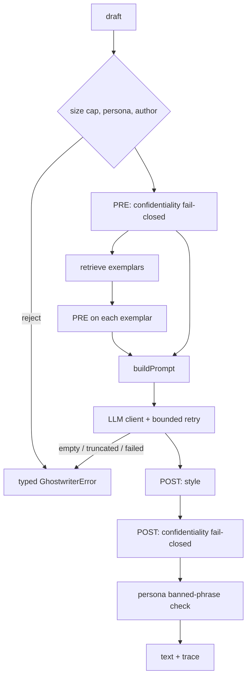

# Architecture

Spooky rewrites a draft along two axes: whose **voice** (source author) and for whom (target **persona**). A filter pipeline wraps the single LLM call. The CLI, the HTTP API and the MCP server are thin adapters over the `Engine` class, generated from one operations registry (`src/service/operations.ts`); every capability exists on every surface (`tests/integration/parity.test.ts` and `tests/integration/surfaces-parity.test.ts` enforce this; see [SURFACES.md](SURFACES.md)).

## Generation flow

```
  draft text
      |
      v
 +-----------+   too big / blank / unknown persona / unknown author
 | size cap  |-- ------------------------------------------------------> typed error, no filter or LLM ran
 +-----------+
      |
      v
 +------------------------+
 | PRE pipeline           |  confidentiality (fail-closed): secrets, blocklist, custom rules -> [REDACTED:type]
 +------------------------+
      |  safe text (the only text used from here on)
      +--------------------------+
      v                          v
 +------------------+     +------------------------------+
 | retrieve k       |<----| redacted query -> hashed     |
 | exemplars        |     | bag-of-words vector -> store |
 +------------------+     +------------------------------+
      |  each exemplar re-run through the PRE pipeline (the ruleset may have changed since ingest)
      v
 +------------------------+
 | buildPrompt            |  system: author profile + persona (mandates, prohibitions)
 | (pure, deterministic)  |  user:   <exemplars>...</exemplars> <input>safe text</input>
 +------------------------+
      |
      v
 +------------------------+
 | LLM client             |  Anthropic SDK | OpenAI-compatible fetch | Mock; bounded retry (429/5xx/network)
 +------------------------+
      |  empty / non-string / oversized / truncated answer = LlmError, no text
      v
 +------------------------+
 | POST pipeline          |  style editor (skip-on-error) -> confidentiality again (fail-closed, always last)
 +------------------------+
      |
      v
 banned-phrase check (persona) -> trace entry only if one survived
      |
      v
 { text, trace[], promptTokensEstimate }
```

The ordering is the security property: the provider only ever sees text the confidentiality filter has already processed, and the answer is processed again before the caller sees it. A pipeline whose trace has no successful `confidentiality` entry is treated as not having run and ends in `FilterFailedError`.



## Ingest flow (source axis)

```
corpus -> size guard -> PRE pipeline (whole corpus, so a secret split across a chunk edge is one match)
       -> stylometric profile (local, no LLM: sentence length, lexical density, punctuation, hedging, active/passive, transitions)
       -> chunk (paragraph/sentence boundaries, size + overlap)
       -> embed (deterministic hashed bag-of-words) -> vector store (in memory; JSON file when a state dir is set)
```

Nothing downstream of the pre pipeline (profile, embedder, store, disk) ever sees the original text. With a state directory, `store.json` and `profiles.json` are written atomically (0600) under an advisory lock, and `Engine.create` validates and restores them.

## Modules

| Directory | Responsibility |
|---|---|
| `src/models/` | All shared types (`types.ts`, single declaration site) and the typed error hierarchy (`errors.ts`; every error is a `GhostwriterError` with a stable `code`). |
| `src/config/` + `config/` | zod schema and `loadConfig`; defaults as data: filter pipeline, personas, phrase list, limits. |
| `src/filters/` | `FilterPipeline` (async, ordered, per-filter `onError`), `ConfidentialityFilter`, `StyleFilter`, protected-span splitter (code, URLs, quotes), config-to-pipeline `registry`. |
| `src/ingestion/` | Chunker, stylometry extractor. |
| `src/embedding/`, `src/store/` | `Embedder` and `VectorStore` interfaces with offline defaults (`HashEmbedder`, `InMemoryVectorStore`). |
| `src/registry/` | `SourceManager` (ingest/retrieve, serialized), `TargetManager` (personas, banned-phrase detection), profile file and state-directory lock. |
| `src/pipeline/` | `buildPrompt`: pure `(profile, exemplars, persona, input) -> {system, user}`, delimiter-neutralizing. |
| `src/llm/` | `LlmClient` adapters (Anthropic, OpenAI-compatible, Mock), retry, endpoint/key-egress policy. |
| `src/orchestration/` | `Orchestrator`: the one place both axes, the filters and the LLM meet. |
| `src/scoring/` + `config/scorer.ts` | AI-likeness scorer: pure `features.ts` (six [0,1] features over prose with protected spans removed), `HeuristicScorer` (weighted mean with an exact per-feature breakdown), `DetectorAdapter` + `HttpDetectorAdapter`, `runEnsemble` (weighted mean; failing/invalid detectors excluded and recorded), `calibration.ts` (AUC, bootstrap). `Engine.score` runs the PRE pipeline first, so the heuristic and every detector see redacted text only. Measured quality: [CALIBRATION.md](CALIBRATION.md). |
| `src/engine.ts` | `Engine` facade: library surface, lazy LLM client, optional persistence. |
| `src/cli/` | commander program; `main()` returns an exit code, `bin.ts` is the shebang entry. |

## Extension points

- **Filter:** implement `Filter`, add its name to `config/filters.ts`, pass a factory to `Engine` (README, "Add a filter in under 20 lines").
- **LLM provider:** implement `LlmClient.complete(req) => Promise<string>` and pass `llm` to `Engine`.
- **Score detector:** implement `DetectorAdapter` (`name`, `score(text, signal?) => Promise<number>` in [0,1], 1 = machine-generated; the signal aborts on timeout) and pass `detectors` to `Engine`, or declare an HTTP one under `scorer.detectors`. It runs only when `score()` names it.
- **Embedder / vector store:** pass `embedder` / `store` to `Engine`; a store needs `save`/`load` only when a state directory is used.
- **Personas, phrases, blocklist, custom redaction rules:** data in the config file.

## Invariants (each pinned by tests)

1. Confidentiality is enabled, fail-closed, present at both stages and last at `post`; `loadConfig` and `buildPipeline` both refuse anything else.
2. Redaction is idempotent and deterministic; trace metadata holds counts and flags, never matched text.
3. Same inputs give byte-identical outputs; no filter holds regex state between calls.
4. Every failure that leaves the engine is a `GhostwriterError` (`tests/torture/engine-torture.test.ts`); the CLI maps each `code` to one exit code.
5. API keys are read from the environment by name only, and sent over https or loopback http only.
