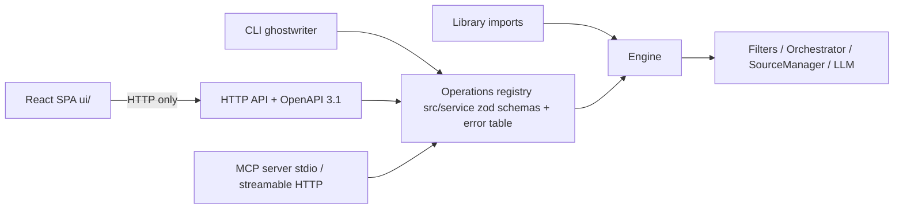

# Surfaces (design, milestone v3)

Status: planned (Phases 9-11). Rule: every capability is available on every surface; one registry declares operations, adapters never re-declare them.

## Surface matrix (today -> target)
| Operation | Library | CLI | HTTP | MCP | UI |
|---|---|---|---|---|---|
| generate | yes | yes | P9 | P9 | P11 |
| ingest | yes | yes | P9 | P9 | P11 |
| profile | yes | yes | P9 | P9 | P11 |
| list authors | yes | gap -> P9 | P9 | P9 | P11 |
| list personas | yes | yes | P9 | P9 | P11 |
| list filters | yes | yes | P9 | P9 | P11 (trace/settings) |
| config get (redacted) | gap -> P9 | gap -> P9 | P9 | P9 | P11 |
| score | P7 | P7 | P9 | P9 | P11 (gated) |
| humanize | P8 | P8 | P9 | P9 | P11 (gated) |

Serve the UI from the API server: one process, one origin, no CORS needed.

## Cross-cutting
- Errors: one table code -> CLI exit code / HTTP status / MCP error; unexpected errors by class name only.
- Security: loopback bind default, optional bearer token, no wildcard CORS, Host/Origin checks, body limits, MCP inputs strict-schema validated, API keys never leave the server.
- Capability discovery: `GET /api/capabilities` lets the UI and clients see which operations exist (score/humanize appear when Phases 7/8 are present).
- Parity: `tests/integration/surfaces-parity.test.ts` fails on any missing capability on any surface.

## Open decisions (need user)
1. HTTP framework: plain `node:http` (recommended: tiny surface, no deps) vs Fastify. Recommend `node:http`.
2. Config `get` only, or also `config set` from the UI/API? Recommend read-only now; writes are a secrets/safety risk.
3. UI tokenless on loopback (recommended default, token optional) or always require a token for the UI+API? Recommend optional token, warn in docs.
4. Black Cat display font and Tron fonts: confirm OFL self-hosted fonts (Orbitron/Inter/JetBrains Mono for Tron; recommend Fraunces or Cormorant for Black Cat). Confirm package name `@fontsource-variable/*` acceptable.
5. Playwright visual baselines: committed PNGs generated in a pinned container (recommended) vs not committed. Recommend committed, small viewport set.
