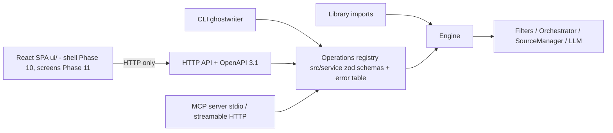

# Surfaces (milestone v3)

Status: Phases 8 (humanize), 9 (registry, CLI, HTTP API, MCP, OpenAPI) and 10 (web UI foundation and theming, [UI.md](UI.md)) built. Phase 11 (the UI feature screens) built; every operation has a screen. Rule: every capability is available on every surface; one registry declares operations, adapters never re-declare them.

## Surface matrix
| Operation | Library | CLI | HTTP | MCP tool | UI |
|---|---|---|---|---|---|
| ingest | `engine.ingest` | `ghostwriter ingest` | `POST /api/ingest` | `ingest` | Authors (ingest form) |
| generate (`mode?`, `notes?`, `length?`, `humanize?`, `target?`) | `engine.generate` | `ghostwriter generate [--topic --notes-file --length] [--humanize --target]` | `POST /api/generate` | `generate` | Generate |
| score | `engine.score` | `ghostwriter score` | `POST /api/score` | `score` | Score / Humanize (Score) |
| profile | `engine.getProfile` | `ghostwriter profile <id>` | `GET /api/profile?authorId=` | `profile` | Authors (profile view) |
| list authors | `engine.listAuthors` | `ghostwriter authors` | `GET /api/authors` | `authors` | Authors, Generate |
| list personas | `engine.listPersonas` | `ghostwriter personas` | `GET /api/personas` | `personas` | Personas, Generate |
| list filters | `engine.listFilters` | `ghostwriter filters` | `GET /api/filters` | `filters` | Settings |
| config get (redacted; includes the state directory path, read-only) | `engine.getConfigView` | `ghostwriter config get` | `GET /api/config` | `config_get` | Settings, limits on Generate |
| capabilities | `describeCapabilities()` | `ghostwriter capabilities` | `GET /api/capabilities` | `capabilities` | Overview, nav gating |
| humanize | `engine.humanize` | `ghostwriter humanize` | `POST /api/humanize` | `humanize` | Score / Humanize (Humanize) |

**Topic mode is one operation, not two.** Writing about a topic is `generate` with `mode: 'topic'` (default `'rewrite'`, so every existing caller is unchanged), `text` meaning the draft or the topic, and optional `notes` and `length`. It was declared once in the registry rather than as a separate `generate_topic` operation because the whole pipeline is shared (persona and author lookup, confidentiality on every input, exemplar retrieval, the model call with retry, the post filters, the humanizer option, the same limits and the same errors): a second operation would duplicate that on every surface and leave the two to drift. The cost is that `notes` and `length` are valid only with `mode: 'topic'`, which the schema (and the Engine, for library callers) enforces with a usage error. The parity test maps the new fields to CLI flags (`mode` -> `--topic`, `notes` -> `--notes-file`, `length` -> `--length`) and a golden test runs one topic request through the library, CLI, HTTP and MCP and requires the same data, caveat included. There is no web search or research behind it; every topic result carries the fixed `caveat`: facts are not verified.

**Pending capabilities.** A capability planned but not built is listed in `PENDING_CAPABILITIES` (`src/service/operations.ts`) and in the `pending` array of every `capabilities` call, so clients can tell "not built yet" from "does not exist"; it has no CLI command, route, tool or OpenAPI path, and the parity test fails the moment the Engine gains the method without a registry entry. The list is empty since Phase 8 built `humanize` ([HUMANIZING.md](HUMANIZING.md)): one registry entry gave it the CLI command, route, tool and OpenAPI path, and `generate` gained `humanize` and `target` on every surface. Its scores come from a weak, confounded heuristic (held-out AUC 0.694); every surface returns that caveat in the result.

Serve the UI from the API server: one process, one origin, no CORS needed. `startApiServer({ staticHandler })` is the mount hook; `src/api/static.ts` is the Phase 10 handler for `ui/dist` ([UI.md](UI.md)); it runs before the token check and sets its own CSP (`applySecurityHeaders(res, csp)`). Because it is unauthenticated it may serve public assets only: it is offered GET/HEAD for paths outside `/api/*`, `/openapi.json` and `/mcp` (all token-protected), and the request target can never begin with `//`.

## How it is built
- `src/service/operations.ts`: the registry. `{ name, description, input (strict zod), output (zod), mutates, openWorld, readsState, engineMethod, http, cli, render, handler }`. `invokeOperation` validates and runs; every surface calls it.
- `src/service/errors.ts`: the error table `code -> { exit, http, mcp }`, `describeError`, `EXIT_CODES` (the CLI imports it).
- `src/service/openapi.ts`: walks the registry with `z.toJSONSchema` into an OpenAPI 3.1 document (deterministic, no hand edits).
- `src/service/runtime.ts`: one Engine for a long-running server, plus a cheap `stat` check that reloads state written by another process (`ghostwriter ingest` while `serve` runs).
- `src/api/`: `node:http` server (`server.ts`), bearer token and Host/Origin/CORS policy (`auth.ts`), body/time/concurrency limits (`limits.ts`).
- `src/mcp/`: tools from the registry (`tools.ts`), stdio and streamable HTTP servers (`server.ts`).
- `src/cli/serve.ts`, `src/cli/mcp.ts`: `ghostwriter serve`, `ghostwriter mcp`.

Same document on every surface: `{ "ok": true, ...data }` or `{ "ok": false, "error": { "code", "message" } }` (CLI `--json`, HTTP body, MCP `structuredContent`). Details: [API.md](API.md), [MCP.md](MCP.md).

## Cross-cutting
- Errors: one table code -> CLI exit code / HTTP status / MCP error result; unexpected errors by class name only. An unknown persona or author is reported without echoing the (possibly secret-shaped) key.
- Security: loopback bind default, optional bearer token (required off loopback), no wildcard CORS, Host/Origin checks, body limits, MCP inputs strict-schema validated, API keys never leave the server.
- Capability discovery: `capabilities` (every surface) lists the operations and the pending ones.
- Parity: `tests/integration/surfaces-parity.test.ts` fails on any missing capability on any surface, on any surface capability the registry lacks, and on a pending capability that gained an adapter. The surfaces are OBSERVED, not read back from the code under test: HTTP routes and accepted input fields are probed on a live server, MCP tools and their schemas come from a real MCP client over HTTP, the CLI from the real commander program, OpenAPI from the served document. Every input field (as seen on any surface) must map to a CLI flag or argument in the test's `CLI_FIELDS` table, and a CLI flag that is no input field must be listed as CLI-only with a reason, so a new field without a flag fails; the test also starts mutated live servers (extra field, rogue route, dropped operation) and requires each to be caught.

## Decisions (DECIDED 2026-11-15, user accepted the recommended option for all five)
1. **HTTP framework: DECIDED `node:http`.** No framework. The whole HTTP surface is one handler in `src/api/server.ts`, routes derived from the registry.
2. **Config: DECIDED read-only.** `config get` only (redacted view; it reports the state directory path, which is a location and not a secret, and never a key or env value). There is no `config set` on any surface; writes from a UI/API are a secrets and safety risk. Revisit only with an explicit design for secret handling.
3. **Token: DECIDED optional bearer token on loopback, with a docs warning.** Tokenless on `127.0.0.1` is the default; `--token-env NAME` turns the token on for every route. The token must have some variety (8+ distinct characters), `NAME` must be a service-specific upper-case name (not `PATH`, a provider key or another system's credential), and wrong tokens are throttled per address (delay, then a 60 s lockout with 429); see [API.md](API.md#threat-model-and-the-tokenless-default). A non-loopback `--host` without a token refuses to start. The warning (any local process can use a tokenless server) is printed at startup and written in [API.md](API.md#threat-model-and-the-tokenless-default).
4. **Fonts: DECIDED self-hosted OFL fonts via `@fontsource-variable/*`** (Orbitron/Inter/JetBrains Mono for Tron; Fraunces or Cormorant for Black Cat), bundled with the UI, no CDN. Applies from Phase 10; no font package is added in Phase 9.
5. **Playwright baselines: DECIDED committed PNGs**, generated in a pinned container, small viewport set. Applies from Phase 10/11; nothing is added in Phase 9.
