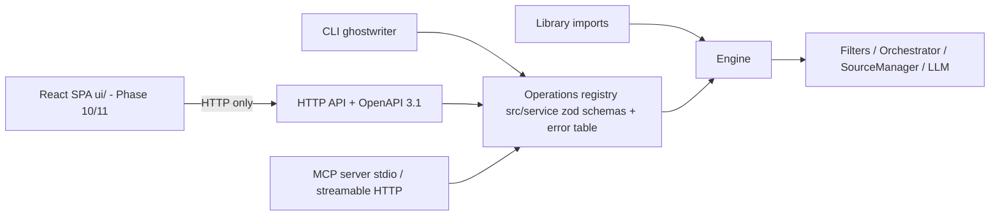

# Surfaces (milestone v3)

Status: Phase 9 built (registry, CLI, HTTP API, MCP, OpenAPI). Phases 10 and 11 (UI) are planned. Rule: every capability is available on every surface; one registry declares operations, adapters never re-declare them.

## Surface matrix
| Operation | Library | CLI | HTTP | MCP tool | UI |
|---|---|---|---|---|---|
| ingest | `engine.ingest` | `ghostwriter ingest` | `POST /api/ingest` | `ingest` | P11 |
| generate | `engine.generate` | `ghostwriter generate` | `POST /api/generate` | `generate` | P11 |
| score | `engine.score` | `ghostwriter score` | `POST /api/score` | `score` | P11 (gated) |
| profile | `engine.getProfile` | `ghostwriter profile <id>` | `GET /api/profile?authorId=` | `profile` | P11 |
| list authors | `engine.listAuthors` | `ghostwriter authors` | `GET /api/authors` | `authors` | P11 |
| list personas | `engine.listPersonas` | `ghostwriter personas` | `GET /api/personas` | `personas` | P11 |
| list filters | `engine.listFilters` | `ghostwriter filters` | `GET /api/filters` | `filters` | P11 (trace/settings) |
| config get (redacted) | `engine.getConfigView` | `ghostwriter config get` | `GET /api/config` | `config_get` | P11 |
| capabilities | `describeCapabilities()` | `ghostwriter capabilities` | `GET /api/capabilities` | `capabilities` | P11 |
| humanize | PENDING (Phase 8) | PENDING | PENDING | PENDING | P11 (gated) |

**Pending capability, not faked.** Phase 8 (humanize) is not built. It is listed in `PENDING_CAPABILITIES` (`src/service/operations.ts`) and in the output of every `capabilities` call (`pending: [{name:'humanize', phase:8}]`), so clients can tell "not built yet" from "does not exist". It has no CLI command, route, tool or OpenAPI path. When Phase 8 adds `Engine.humanize()`, the parity test (`tests/integration/surfaces-parity.test.ts`) fails until the registry has an `humanize` operation; adding that one registry entry creates its CLI command (if declared `derived` or hand-wired like `score`), HTTP route, MCP tool and OpenAPI path, and the entry moves out of `PENDING_CAPABILITIES`.

Serve the UI from the API server: one process, one origin, no CORS needed. `startApiServer({ staticHandler })` is the mount hook for Phase 10; it runs before the token check and sets its own CSP (`applySecurityHeaders(res, csp)`). Because it is unauthenticated it may serve public assets only: it is offered GET/HEAD for paths outside `/api/*`, `/openapi.json` and `/mcp` (all token-protected), and the request target can never begin with `//`.

## How it is built
- `src/service/operations.ts`: the registry. `{ name, description, input (strict zod), output (zod), mutates, openWorld, readsState, engineMethod, http, cli, render, handler }`. `invokeOperation` validates and runs; every surface calls it.
- `src/service/errors.ts`: the error table `code -> { exit, http, mcp }`, `describeError`, `EXIT_CODES` (the CLI imports it).
- `src/service/openapi.ts`: walks the registry with `z.toJSONSchema` into an OpenAPI 3.1 document (deterministic, no hand edits).
- `src/service/runtime.ts`: one Engine for a long-running server, plus a cheap `stat` check that reloads state written by another process (`ghostwriter ingest` while `serve` runs).
- `src/api/`: `node:http` server (`server.ts`), bearer token and Host/Origin/CORS policy (`auth.ts`), body/time/concurrency limits (`limits.ts`).
- `src/mcp/`: tools from the registry (`tools.ts`), stdio and streamable HTTP servers (`server.ts`).
- `src/cli/serve.ts`, `src/cli/mcp.ts`: `ghostwriter serve`, `ghostwriter mcp`.

Same document on every surface: `{ "ok": true, ...data }` or `{ "ok": false, "error": { "code", "message" } }` (CLI `--json`, HTTP body, MCP `structuredContent`). Details: [API.md](API.md), [MCP.md](MCP.md).

## Cross-cutting
- Errors: one table code -> CLI exit code / HTTP status / MCP error result; unexpected errors by class name only. An unknown persona or author is reported without echoing the (possibly secret-shaped) key.
- Security: loopback bind default, optional bearer token (required off loopback), no wildcard CORS, Host/Origin checks, body limits, MCP inputs strict-schema validated, API keys never leave the server.
- Capability discovery: `capabilities` (every surface) lists the operations and the pending ones.
- Parity: `tests/integration/surfaces-parity.test.ts` fails on any missing capability on any surface, on any surface capability the registry lacks, and on a pending capability that gained an adapter.

## Decisions (DECIDED 2026-11-15, user accepted the recommended option for all five)
1. **HTTP framework: DECIDED `node:http`.** No framework. The whole HTTP surface is one handler in `src/api/server.ts`, routes derived from the registry.
2. **Config: DECIDED read-only.** `config get` only (redacted view). There is no `config set` on any surface; writes from a UI/API are a secrets and safety risk. Revisit only with an explicit design for secret handling.
3. **Token: DECIDED optional bearer token on loopback, with a docs warning.** Tokenless on `127.0.0.1` is the default; `--token-env NAME` turns the token on for every route. The token must have some variety (8+ distinct characters), `NAME` must be a service-specific upper-case name (not `PATH`, a provider key or another system's credential), and wrong tokens are throttled per address (delay, then a 60 s lockout with 429); see [API.md](API.md#threat-model-and-the-tokenless-default). A non-loopback `--host` without a token refuses to start. The warning (any local process can use a tokenless server) is printed at startup and written in [API.md](API.md#threat-model-and-the-tokenless-default).
4. **Fonts: DECIDED self-hosted OFL fonts via `@fontsource-variable/*`** (Orbitron/Inter/JetBrains Mono for Tron; Fraunces or Cormorant for Black Cat), bundled with the UI, no CDN. Applies from Phase 10; no font package is added in Phase 9.
5. **Playwright baselines: DECIDED committed PNGs**, generated in a pinned container, small viewport set. Applies from Phase 10/11; nothing is added in Phase 9.
